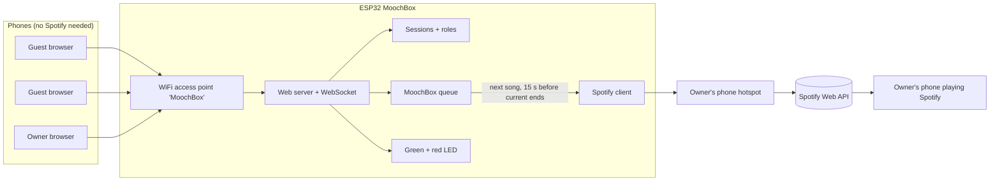
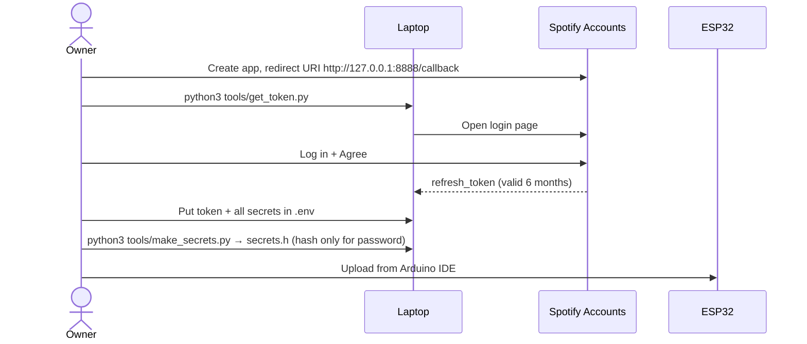
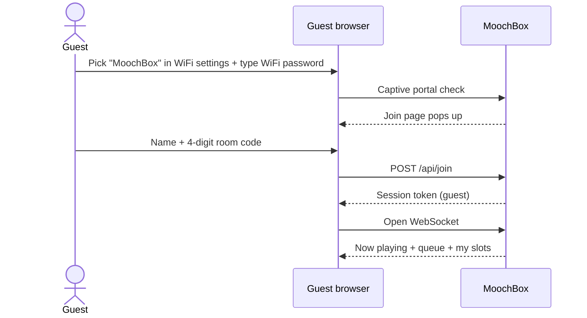
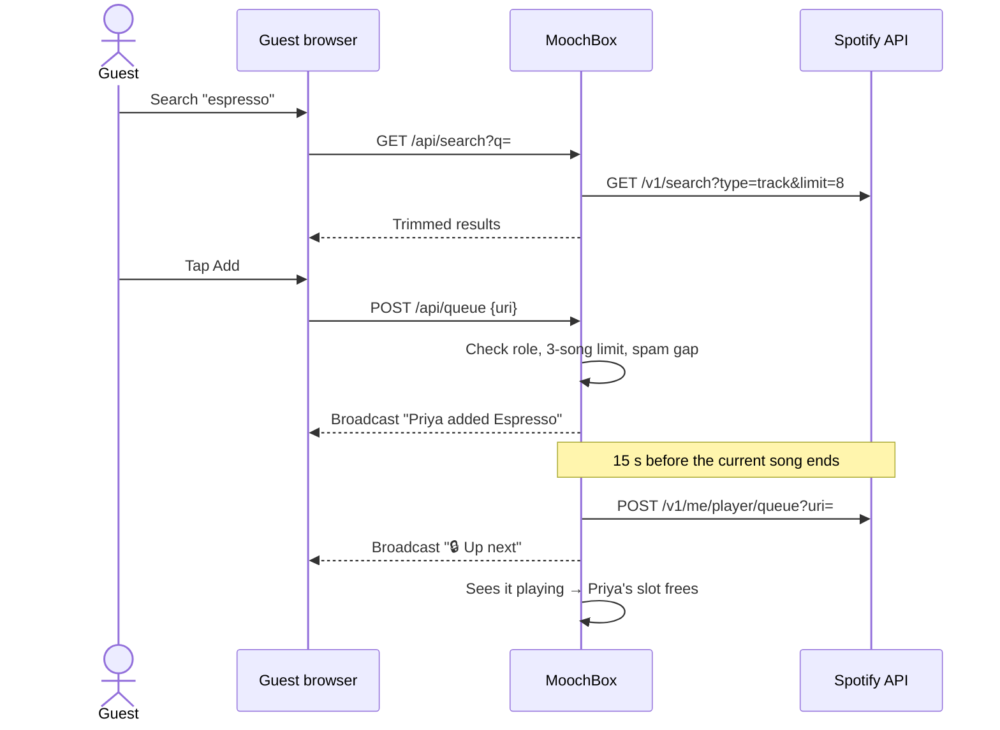
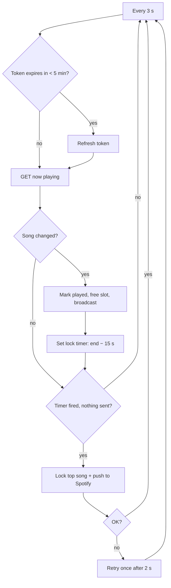

# MoochBox: Shared Spotify Queue on an ESP32

> One owner with Spotify Premium. Guests join MoochBox's WiFi, enter a 4-digit room code that only the owner can see, and add songs from their phone browser. MoochBox feeds the songs into the owner's Spotify. Guests need no Spotify account, no Premium and no app.
---

## 0. At a glance

| | |
|---|---|
| **Status** | Planning done, no code yet |
| **Board** | ESP32-D0WD-V3 (classic ESP32, ~520 KB RAM, 4 MB flash) |
| **Hardware in the build** | ESP32 + green LED + red LED + 2 resistors + jumper wires |
| **Toolchain** | Arduino IDE 2 + Espressif ESP32 core (already set up) |
| **Time box** | 4 hours |
| **Cost** | $0 beyond the owner's existing Spotify Premium |

---

## 1. The idea

| Problem | Only Premium users can join a Spotify Jam. Most friends don't have Premium. |
|---|---|
| **Fix** | MoochBox is logged in to Spotify **as the owner**. Guests add songs to MoochBox's queue, and MoochBox adds them to the owner's Spotify one at a time. |
| **Result** | Spotify only sees the owner. Guests never touch Spotify. |

---

## 2. Cost

| Item | Cost | Notes |
|---|---|---|
| Spotify Web API | Free | No fee to register an app or call the API |
| Spotify Premium (owner) | Existing subscription | Required: dev-mode apps only work if the owner has Premium; Add to Queue is Premium-only |
| Guest accounts | None | Guests never log in to Spotify, so they don't count toward the app's 5-user limit |
| Server / hosting | None | The ESP32 is the server |

**Spotify dev-mode limits (Feb 2026 rules):** 5 authorized users max (we use 1) · search returns ≤10 results · non-commercial use only.

---

## 3. Architecture

### 3.1 Overview



### 3.2 Two WiFi roles at once

| Role | Purpose |
|---|---|
| **Access point** | Creates the `MoochBox` network that guests join |
| **Station** | Joins the owner's phone hotspot so MoochBox can reach Spotify |

### 3.3 Why MoochBox keeps its own queue

Spotify's API can **add** to the queue but **can't remove or reorder**. Removing, swapping and votes need that, so:

- The **real queue lives on MoochBox**.
- Spotify only ever holds **the one song that plays next**.

```
MoochBox queue (editable)              Spotify queue (add-only)
┌───────────────────────────┐          ┌──────────────────────┐
│ 1. Espresso      (Priya)  │ ──push──▶│ next: Espresso       │
│ 2. Pink Pony Club (Sam)   │  15 s    └──────────────────────┘
│ 3. Levitating    (Priya)  │  before
└───────────────────────────┘  the end
```

### 3.4 Lock timing

| Step | When | What guests see |
|---|---|---|
| Countdown | 30 s before the lock | `⏳ locks in 0:12` on the top song. Last chance to swap or vote it out. |
| Lock + send | **15 s before the current song ends** (host can set 8–30 s) | `🔒 Up next`, sent to Spotify, can't change |

- **Why not 5 s:** one HTTPS request from the ESP32 can take 1–2 s; with a slow hotspot, a 5 s push often arrives after the song ends, and Spotify autoplay slips in a random song.
- **15 s** leaves time for one retry.
- MoochBox sets its own timer from Spotify's `progress_ms` and `duration_ms`, so the lock is on time between polls.

---

## 4. Roles and access

### 4.1 Roles

| Role | How you get it | Can do |
|---|---|---|
| **Owner** (Arshiya) | Owner password (§4.3) | Everything + make/remove hosts + **see the room code, make a new one** |
| **Host** | Owner taps **Make host** on a person | Skip, pause, lock adding, kick one person, edit rules, remove/reorder any song, make/remove DJs |
| **DJ** | Owner or host taps **Make DJ** | Remove/reorder anyone's songs. Nothing else. |
| **Guest** | WiFi password + room code + a name | Search, add (up to the limit), remove/swap **own** songs, vote |

- Only the owner can make or remove hosts.
- Nobody can become owner. There's only the password.

### 4.2 Nobody can fake being host

- Names are labels only. Power comes from the **role attached to the session token** on the ESP32.
- Badges (👑 ⭐ 🎧) come from the server.
- Blocked names: `host`, `owner`, `admin`, `dj`, `moochbox`. Names must be unique (`Priya` → `Priya 2`).
- Every action is checked on the ESP32, not just hidden in the page.

### 4.3 Owner password

| | |
|---|---|
| **Who sets it** | Only Arshiya, on Arshiya's laptop |
| **Where it lives** | `MOOCHBOX_OWNER_PASSWORD` in the project's `.env` file (gitignored, on Arshiya's laptop only) |
| **How it gets to the box** | `tools/make_secrets.py` reads `.env`, hashes the password (salted SHA-256), and writes only the **hash** into the gitignored `secrets.h`. Then upload from Arduino IDE. |
| **Missing or < 10 chars** | The script stops with an error. No `secrets.h`, no build. |
| **Change / forgot it** | Edit `.env` → rerun the script → upload again. Old owner sessions stop working. |
| **Can't be changed from** | The web app or any phone |
| **Guessing protection** | 5 wrong tries from one device → 5-minute lockout; failed-try count on the owner panel |

> Use a password you don't use anywhere else. Someone with the box and a USB cable could read the hash off the flash and try guessing offline.

### 4.4 Locks on the room

| Lock | Set by | Who knows it | Protects | Required |
|---|---|---|---|---|
| **WiFi password** (WPA2, 8+ chars) | Owner, in `.env` | Anyone you let on the network | Keeps strangers off the network; encrypts traffic over the air | **Yes** |
| **Room code** (4 digits) | **Generated by MoochBox** | **Owner only** | Getting into the room: seeing or touching the queue | **Yes** |
| **Owner password** | Arshiya, in `.env` | Arshiya only | Owner role | **Yes** |

Being on the WiFi is **not** enough. Without a session from the room code, every request and the WebSocket are rejected.

### 4.5 Room code

| | |
|---|---|
| **Format** | 4 digits, e.g. `4827` |
| **Made** | Automatically, with the ESP32's hardware random generator, **every time MoochBox starts**. Skips easy ones (`0000`, `1111`, `1234`, …). |
| **Who sees it** | **Only the owner**, on the owner panel. Hosts, DJs and guests never see it. Also printed on Serial Monitor for testing on the laptop. |
| **New code** | Owner taps **New code** → a fresh code, and **every guest and DJ is logged out**. Owner and hosts stay. |
| **Stored** | In RAM only. Not in `.env`, not in NVS. A reboot = a new code (and everyone rejoins). |
| **Guessing protection** | 5 wrong tries from one phone → 60 s lockout. More than 20 wrong tries in a minute from anyone → joining pauses for 60 s. The owner panel shows the failed-try count. |

### 4.6 Kicking

| Action | Who | What happens |
|---|---|---|
| **Kick one person** | Owner / host | Ends their session and **blocks their phone** (by its WiFi MAC address). Even with the WiFi password and room code, that phone can't rejoin. |
| **Kick everyone** | **Owner** | **New code.** All guests and DJs are logged out and can't rejoin without the new code. |

### 4.7 Sessions

| Role | Lasts | Ends early when |
|---|---|---|
| Owner | 6 h | Logs out, or a new owner password is uploaded |
| Host | 6 h | Logs out, or the owner removes host |
| DJ / Guest | 6 h | New room code, kicked, logs out, or MoochBox restarts |

- Token: random 128-bit, stored in the phone's `localStorage`. A refresh keeps you logged in and keeps your songs yours.

> **Security note:** the local site is plain HTTP. WPA2 (the WiFi password) encrypts it over the air. Party-level security, not bank-level.

---

## 5. Queue rules

All editable by owner/host unless marked.

| Rule | Default | Range |
|---|---|---|
| Songs waiting per person | **3**. A slot frees when one of your songs **starts playing**. | 1–10 or off |
| Anti-spam gap between adds | 5 s | editable |
| Remove / swap own songs | Always, until the song is locked | fixed |
| Remove other people's songs | Owner, hosts, DJs. Guests only by vote. | — |
| Vote to remove | On. 50% of active guests, min 3 votes, within 60 s | editable |
| Vote to skip | On. Same threshold. Skips right away when it passes. | editable |
| Queue order | First-come | — |
| Lock adding | Off | owner/host toggle |
| Lock + send next song | 15 s before the end | 8–30 s |

**Details:**

- **Slot tracking:** when a locked song is seen **playing**, it's done and its adder gets the slot back. If it never plays (the owner skipped past it in Spotify), it times out and the slot frees anyway.
- **Swap:** pick a new song; it keeps the old song's place.
- **Why votes, not a code, for removing others' songs:** a shared code leaks once one person sees it. Votes need several people to agree, and DJs cover trusted friends.

---

## 6. Flows

### 6.1 One-time setup (laptop, ~20 min)



**Why a laptop script:** Spotify allows `http://` redirect URIs only for `127.0.0.1`, not for the ESP32's address. So the Spotify login happens once on the laptop, and the ESP32 only uses the refresh token.

### 6.2 At the party: owner

1. Turn on the phone hotspot (iPhone: **Maximize Compatibility** on, for 2.4 GHz).
2. Plug in MoochBox → wait for **solid green**.
3. Open Spotify on the phone and **press play**.
4. Join `MoochBox` WiFi → **Owner login** → password → owner panel.
5. Read the **room code** off the owner panel and tell friends the code + WiFi password.

### 6.3 Guest joins



### 6.4 Add a song → Spotify



### 6.5 Background loop



### 6.6 Votes

| | Vote to remove | Vote to skip |
|---|---|---|
| Target | A waiting song (not your own) | The playing song (not your own) |
| Shown as | `remove? 2/4` on the song | `⏭ skip? 2/4` under now playing |
| Passes | Threshold within 60 s | Threshold within 60 s |
| On pass | Song removed; adder gets the slot back | Spotify skip right away. If no song is locked yet, MoochBox locks + sends the top song first, so autoplay doesn't sneak in. |
| Resets | After 60 s | When a new song starts |

One vote per person.

---

## 7. Features

### 7.1 MVP (the 4-hour build)

| # | Feature | Ref |
|---|---|---|
| M1 | `MoochBox` access point + connection to the owner's hotspot | §3.2 |
| M2 | Captive portal: join page pops up | §6.3 |
| M3 | Join with name + **auto 4-digit room code** (owner-only, new each boot); blocked/unique names; 6 h sessions; kick = block phone | §4.5–4.7 |
| M4 | Owner login with the owner password | §4.3 |
| M5 | Roles: Owner / Host / DJ / Guest | §4.1 |
| M6 | Search (8 results, trimmed) | §6.4 |
| M7 | MoochBox queue + lock-and-send 15 s before the end | §3.3–3.4 |
| M8 | 3 songs waiting per person, freed when one plays | §5 |
| M9 | Remove / swap own songs | §5 |
| M10 | Live now playing + queue + activity on every phone | WebSocket |
| M11 | Owner/host panel: skip, pause, lock adding, kick, rules, roles; **owner only:** room code + New code | §8 |
| M12 | Clear error messages | §10.6 |
| M13 | Green + red status LEDs | §9 |
| M14 | Vote to remove | §6.6 |
| M15 | Vote to skip | §6.6 |

### 7.2 Not in scope

- Audio on the ESP32
- Removing songs from Spotify's own queue (the API can't)
- More than ~10 guests on MoochBox WiFi (ESP32 limit)
- Internet access for guests (§11.2)
- Anything in §13

---

## 8. Screens

Mobile-first, dark theme, big buttons. Songs show a **colored tile with initials** instead of album art.

**Join**
```
┌──────────────────────────┐
│        🎵 MoochBox        │
│  Your name   [ Priya    ] │
│  Room code   [ _ _ _ _  ] │
│  [      Join the jam     ]│
│  Wrong code (3 tries left)│
│        Owner login        │
└──────────────────────────┘
```

**Guest main**
```
┌──────────────────────────┐
│ MoochBox    👤 6   Priya  │
├──────────────────────────┤
│ NOW PLAYING               │
│ ▶ Blinding Lights · Sam   │
│   ━━━━━━━━━○──── 2:41     │
│   [ ⏭ vote skip 2/4 ]     │
├──────────────────────────┤
│ UP NEXT                   │
│ 1. Espresso        Priya  │
│    ⏳ locks in 0:12        │
│ 2. Pink Pony Club   Sam   │
│    [vote remove 1/4]      │
│ 3. Levitating      Priya  │
│    [Swap] [Remove]        │  ← my song
├──────────────────────────┤
│ 🔍 Search a song...       │
│ Your songs waiting: 2 / 3 │
└──────────────────────────┘
```

**Owner / host panel** (`/host`)
```
┌──────────────────────────┐
│ 👑 OWNER PANEL     Logout │
├──────────────────────────┤
│ Spotify ● connected       │
│ Device  iPhone (active)   │
│ Guests  6 / 10            │
├──────────────────────────┤
│ [⏭ Skip] [⏯ Pause] [🔒 Lock]│
├──────────────────────────┤
│ ROOM CODE  4 8 2 7        │  ← owner only
│ [New code → logs out all] │
│ Failed join tries: 2      │
├──────────────────────────┤
│ Songs per person   [ 3 ▾] │
│ Vote remove        [ on ] │
│ Vote skip          [ on ] │
│ Vote threshold     [50%▾] │
│ Lock + send at     [15s▾] │
├──────────────────────────┤
│ ⭐ Sam   2 songs   [⋯]    │
│ 🎧 Ravi  1 song    [⋯]    │
│    Priya 2 songs   [⋯]    │
│ [⋯] Make host · Make DJ · │
│     Remove role · Kick    │
├──────────────────────────┤
│ Failed owner logins: 0    │
└──────────────────────────┘
```

---

## 9. Physical box

### 9.1 Parts

| Part | Pin | Resistor |
|---|---|---|
| Green LED | GPIO 18 | 220–1 kΩ |
| Red LED | GPIO 19 | 220–1 kΩ |

**Wiring for each LED:** `GPIO → resistor → LED long leg (+)`, `LED short leg (−) → GND`.

### 9.2 LED meanings

| Green | Red | Meaning |
|---|---|---|
| Blinking | off | Connecting to hotspot / Spotify |
| **Solid** | off | All good |
| Quick double flash | off | A song was added |
| off | **Solid** | Error: no internet or Spotify login broken |
| off | Blinking | No active Spotify device. Owner: press play. |

---

## 10. Technical design

### 10.1 Stack

| Layer | Choice |
|---|---|
| IDE | Arduino IDE 2, board **ESP32 Dev Module** (Espressif ESP32 core v3.x) |
| Web server + WebSocket | **ESPAsyncWebServer** + **AsyncTCP** (ESP32Async versions, via Library Manager) |
| Captive portal | `DNSServer` (built in) |
| HTTPS to Spotify | `WiFiClientSecure` + `HTTPClient` (built in) |
| JSON | **ArduinoJson** v7, with a filter to keep only needed fields |
| Storage | `Preferences` (NVS) for the refresh token + settings |
| Web pages | Plain HTML/CSS/JS, **embedded as strings in a header** (no filesystem upload plugin needed) |
| Laptop scripts | Python 3, standard library only |

### 10.2 Secrets

All secrets live in **one file: `.env` at the top of the project** (next to `plan.md`). `tools/make_secrets.py` turns it into `MoochBox/secrets.h`. Both are **gitignored**. A `.env.example` with blank values is committed so the format is clear.

| `.env` key | What | In `secrets.h` as |
|---|---|---|
| `MOOCHBOX_OWNER_PASSWORD` | Owner password | **Salted hash only** |
| `MOOCHBOX_WIFI_PASSWORD` | `MoochBox` network password (8+ chars) | Plain |
| `MOOCHBOX_HOTSPOT_SSID` / `_PASSWORD` | Owner's phone hotspot | Plain |
| `SPOTIFY_CLIENT_ID` / `_SECRET` | Spotify dashboard | Plain |
| `SPOTIFY_REFRESH_TOKEN` | From `get_token.py` | Plain (copied to NVS on first boot) |

**Never committed:** `.env`, `secrets.h`, any token file.

**Why `.nosync`:** the project folder name keeps it (and `.env`) out of iCloud Desktop sync, so secrets stay on this laptop only.

### 10.3 Data on the ESP32

```
Session   { token, name, role, expiresAt }
QueueItem { id, uri, title, artist, durationMs, addedBy, state: waiting|locked|playing }
Vote      { target, kind: remove|skip, voters[], startedAt }
Settings  { roomCode (RAM only), bannedMacs[], perPersonLimit, spamGapS, voteRemoveOn, voteSkipOn, thresholdPct, voteMin, lockAtS }
```

### 10.4 Local API (phone ↔ MoochBox)

| Method | Path | Min role | Purpose |
|---|---|---|---|
| GET | `/` | none | Join page (captive portal target) |
| POST | `/api/join` | room code | `{name, code}` → guest token |
| POST | `/api/owner/login` | owner password | → owner token |
| POST | `/api/logout` | any | End session |
| GET | `/api/search?q=` | guest | Search |
| POST | `/api/queue` | guest | Add `{uri}` |
| DELETE | `/api/queue/<id>` | own song / DJ | Remove |
| POST | `/api/queue/<id>/swap` | own song / DJ | Replace, keep position |
| POST | `/api/queue/<id>/move` | DJ | Reorder |
| POST | `/api/vote` | guest | `{target, kind}` |
| WS | `/ws?token=` | guest | Live updates |
| POST | `/api/host/skip` · `pause` · `lock` | host | Controls |
| GET | `/api/owner/code` | **owner** | Current room code |
| POST | `/api/owner/new-code` | **owner** | New code, logs out guests + DJs |
| POST | `/api/host/kick` | host | End session + block that phone's MAC |
| POST | `/api/host/rules` | host | Edit §5 |
| POST | `/api/host/role` | host (DJ) / owner (host) | Set a role |

### 10.5 Spotify calls

| Purpose | Call | Scope |
|---|---|---|
| Refresh token | `POST accounts.spotify.com/api/token` | — |
| Search | `GET /v1/search?type=track&limit=8` | `user-read-private` |
| Add to queue | `POST /v1/me/player/queue?uri=` | `user-modify-playback-state` |
| Now playing | `GET /v1/me/player/currently-playing` | `user-read-currently-playing` |
| Skip / pause / play | `POST /next` · `PUT /pause` · `PUT /play` | `user-modify-playback-state` |
| Devices | `GET /v1/me/player/devices` | `user-read-playback-state` |

**Tokens:** the access token lasts 1 h; refresh 5 min early or on `401`. The refresh token lasts 6 months; save a new one if Spotify returns it. `invalid_grant` → red LED + "re-run get_token.py" on the owner panel.

### 10.6 Errors

| Situation | MoochBox does |
|---|---|
| `401` | Refresh token, retry once |
| No active device | Guests: "Owner needs to press play"; red blinks; queue waits |
| `429` | Wait `Retry-After`; slow the poll |
| `403` | Owner panel: "Premium / allowlist problem" |
| Hotspot drops | AP + queue stay up; retry every 10 s; red solid |
| Owner skips in the Spotify app | Next poll catches it; schedule continues |
| Reboot | Queue lost (MVP); settings + token kept in NVS |

### 10.7 Memory

- ~300 KB free heap; one HTTPS connection ≈ 40–50 KB.
- **One Spotify request at a time.**
- Search `limit=8` + JSON filter → < 4 KB parsed.
- Max ~10 sessions, ~30 queue items, last 20 events.

### 10.8 Files

```
ESP.nosync/
├── plan.md
├── .env                    ← all secrets (gitignored, never committed)
├── .env.example            ← same keys, blank values (committed)
├── .gitignore              ← .env, secrets.h
├── MoochBox/               ← Arduino sketch folder (open MoochBox.ino)
│   ├── MoochBox.ino        ← setup + loop
│   ├── net.cpp/.h          ← AP + station + captive DNS
│   ├── spotify.cpp/.h      ← tokens + API calls
│   ├── moochqueue.cpp/.h   ← queue, limits, lock timer
│   ├── sessions.cpp/.h     ← room code, names, roles, kicks/blocks, lockouts
│   ├── votes.cpp/.h        ← remove + skip votes
│   ├── web.cpp/.h          ← HTTP routes + WebSocket
│   ├── leds.cpp/.h         ← green + red LED patterns
│   ├── pages.h             ← HTML/CSS/JS as strings
│   └── secrets.h           ← generated, gitignored
└── tools/
    ├── get_token.py        ← one-time Spotify login
    └── make_secrets.py     ← .env → secrets.h (hashes owner password)
```

---

## 11. Risks

### 11.1 Risk table

| Risk | Plan |
|---|---|
| ESP32 AP allows ~10 phones | Cap at 10; bigger groups use hotspot mode (everyone on the owner's hotspot, open MoochBox by IP) |
| Lock-and-send misses the window | 15 s default, own timer, one retry; push right away for songs < 30 s |
| Captive popup doesn't appear | Show `http://192.168.4.1` in the join instructions |
| iPhone drops a "no internet" WiFi | Answer iOS/Android check URLs so phones treat it as signed in. Test early. |
| Owner password guessed | 10+ chars, 5-try lockout, failed-try counter |
| 4-digit code guessed | Per-phone + global lockouts; failed-try count on the panel; owner taps New code |
| WiFi password spreads beyond friends | Fine: they still need the room code |
| Kicked phone changes its MAC (e.g. iPhone "rotating" private address) | Block won't hold. Owner taps New code. |
| No active Spotify device | Message + red blink; queue waits |
| RAM runs out | One Spotify request at a time, small JSON, test with 5+ phones early |
| Hotspot is 5 GHz only | iPhone: Maximize Compatibility |
| App outgrows flash (milestone 1 already uses 85% of the default 1.3 MB) | Arduino IDE → Tools → Partition Scheme → **Huge APP (3MB No OTA)** once the web server is added |
| Owner queues in the Spotify app directly | Those play first; MoochBox's songs follow. Fine. |

### 11.2 Guests and internet

```
Guest ──▶ MoochBox ──▶ owner's hotspot ──▶ Spotify API   ✅ search + queue work
Guest ──▶ MoochBox ──✖ anything else                     ❌ no internet
```

- MoochBox calls Spotify **for** the guest, so search and queueing work.
- MoochBox is **not a router**: guests can't browse on the owner's data.
- Album art can't load (it's on Spotify's image server) → colored initials tiles. Covers are in §13.

---

## 12. Build timeline (4 h)

| Time | Milestone | Done when |
|---|---|---|
| 0:00–0:20 | Spotify app, `get_token.py`, `.env` filled, `make_secrets.py`, libraries installed | `secrets.h` generated; sketch compiles |
| 0:20–0:55 | `spotify.cpp`: refresh, search, add to queue, now playing **(written, compiles)** | Song typed in Serial Monitor plays on the owner's phone |
| 0:55–1:30 | AP + station + captive portal + join + sessions/roles + owner login | Page pops up; wrong code rejected; only the owner sees the code |
| 1:30–2:20 | `moochqueue.cpp`: queue, 3-per-person, lock timer, played detection | 3 songs from 2 phones play in order; slots free |
| 2:20–2:50 | Guest page: search, add, remove, swap, live updates | 2 phones see each other's changes live |
| 2:50–3:15 | Owner/host panel | Kicked phone can't rejoin; New code logs everyone out; DJ can remove any song |
| 3:15–3:30 | LEDs + error states | Hotspot off → red + message |
| 3:30–3:50 | Vote to remove + vote to skip | 3 phones vote out a song and skip one |
| 3:50–4:00 | Demo run with 3+ phones | |

---

## 13. What's next (after the build)

| # | Idea | Notes |
|---|---|---|
| N1 | Reactions 🔥 💀 ❤️ | Floating emoji on everyone's screen; no Spotify calls |
| N2 | Album covers | MoochBox downloads the 64×64 cover (~4 KB) and serves it locally; optional blurry 8×8 (< 1 KB) style |
| N3 | Round-robin order | One song per person in turn |
| N4 | Join QR on the owner panel | Scan to join the WiFi (QR holds the network name + password) |
| N5 | **Buzzer** | Chirp on add, low buzz on error, boot jingle |
| N6 | **Button** | Short press = skip, long press = lock adding |
| N7 | **White LED** | Flash on each add |
| N8 | **NFC tap-to-join tag** | Tag on the box opens the join page (phones read tags, no reader needed) |
| N9 | Party recap | Top adders, most 🔥 song, play history |
| N10 | Queue survives reboots | Save to NVS |
| N11 | No duplicates | Block a song that's already waiting |
| N12 | OLED screen | Now playing on the box |
| N13 | Case | 3D-printed or tin |

---

## 14. Before building

- [x] Arduino IDE installed, ESP32 board + port configured, test sketch uploaded
- [ ] Spotify app created (redirect `http://127.0.0.1:8888/callback`, Web API ticked)
- [ ] Libraries installed: ArduinoJson, ESPAsyncWebServer, AsyncTCP
- [ ] `.env` filled in (§10.2)
- [ ] Hotspot set to Maximize Compatibility
- [ ] Green + red LEDs wired (§9.1)

---

## 15. Decisions

| # | Decision |
|---|---|
| D1 | Name: **MoochBox** |
| D2 | Default mode: MoochBox's own WiFi + join popup; hotspot mode as fallback |
| D3 | Owner login: **password only**, set only by Arshiya in the gitignored `.env` |
| D4 | Only the owner makes/removes hosts |
| D5 | Guests get no internet; no album art in the MVP |
| D6 | Hardware in the build: **green + red LED only**. Buzzer, button, white LED, NFC → §13 |
| D7 | Votes to remove and to skip are in the MVP |
| D8 | Toolchain: **Arduino IDE**, sketch at `MoochBox/MoochBox.ino` inside this repo; secrets in `.env` → `make_secrets.py` → `secrets.h` (both gitignored) |
| D9 | **Room code:** auto 4 digits, new every boot, **owner-only** to see or renew. Kick = block the phone; New code = kick everyone. WiFi password stays as the outer lock. |
